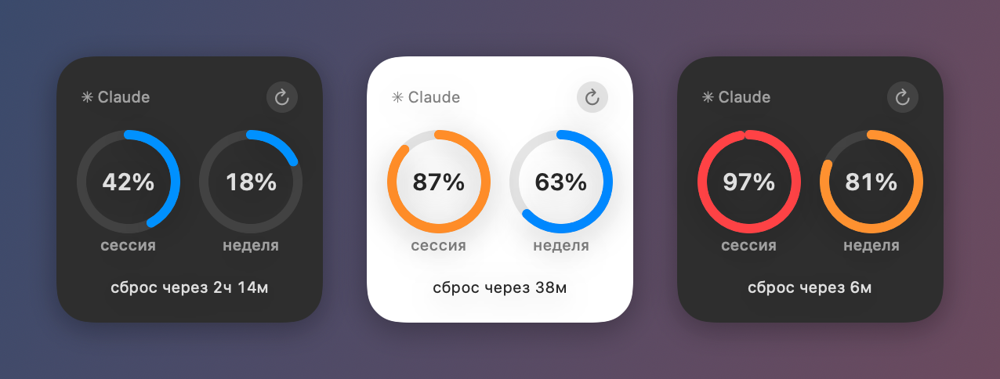

# Claude Limits Widget

Лимиты Claude Code на Mac: проценты в строке меню и маленький виджет на рабочем столе.

*macOS menu bar app and desktop widget that show your Claude Code session (5-hour) and weekly usage. It only asks the server when you press refresh. UI is in Russian.*



## Что показывает

- **Сессия (5 ч)** — сколько процентов 5-часового лимита уже израсходовано.
- **Неделя** — то же для недельного лимита.
- **Сброс через …** — когда обнулится 5-часовой лимит. Отсчёт идёт по часам Mac, без запросов к серверу.

В строке меню: `✳ 42% · 18%`. В меню под ним сброс недельного лимита, отдельные лимиты Opus и Sonnet (если сервер их присылает) и время последнего обновления.

Цвета: от 80% оранжевый, от 95% красный. Если последнее обновление не удалось (нет сети, истёк вход), цифры становятся серыми: они могли устареть. При пересечении 80% и 95% приходит уведомление, один раз за окно лимита.

## Обновление только по кнопке

Программа ничего не запрашивает сама: ни по таймеру, ни при запуске. Данные загружаются, только когда вы нажимаете **«Обновить»** в меню или **↻** на виджете. Строка меню и виджет обновляются одновременно.

Защита от лишних запросов:
- не чаще одного раза в минуту;
- если сервер ответил 429 («слишком часто»), пауза от 15 минут до часа или столько, сколько попросил сервер;
- при ошибке сети пауза от 1 до 15 минут;
- если вход отклонён, тот же токен повторно не отправляется, пока Claude Code не обновит вход.

## Как это устроено

```
 Claude Code ──(вход в связке ключей)──▶ ClaudeLimits.app ──GET /api/oauth/usage──▶ api.anthropic.com
                                               │
                                               │ widget-snapshot.json (общая папка app group)
                                               ▼
                                     виджет на рабочем столе
                                               │
                                     ↻ ── claudelimits://refresh ──▶ ClaudeLimits.app
```

1. **Вход.** Программа берёт токен, который Claude Code уже сохранил в связке ключей macOS (запись `Claude Code-credentials`), через системную утилиту `security`. Токен нигде не сохраняется и уходит только на `api.anthropic.com`.
2. **Запрос.** `GET https://api.anthropic.com/api/oauth/usage`. Это неофициальный адрес, которым пользуется сам Claude Code; формат ответа может измениться.
3. **Виджет.** После каждого обновления программа записывает проценты и время сброса в маленький JSON-файл в общей папке (app group) и просит систему перерисовать виджет. Сам виджет работает в песочнице, в сеть не ходит и токена не видит: он только читает этот файл.
4. **Кнопка ↻.** Открывает ссылку `claudelimits://refresh`. Если программа не запущена, macOS её запустит, а она выполнит обычное «Обновить».

## Установка

Нужно:
- macOS 14 или новее;
- Xcode (нужны компилятор Swift и SDK);
- сертификат **Apple Development** в связке ключей. Хватит бесплатного Apple ID: Xcode → Settings → Accounts → добавить Apple ID → Manage Certificates → «+» → Apple Development. Без настоящей подписи macOS не разрешит программе и виджету общую папку;
- установленный и залогиненный [Claude Code](https://claude.com/claude-code).

```bash
git clone https://github.com/Sidorin7/claude-limits-widget.git
cd claude-limits-widget
./build.sh
open ~/Applications/ClaudeLimits.app
```

`build.sh` собирает программу и виджет, подписывает их первым найденным сертификатом Apple Development (Team ID берёт из него же) и ставит в `~/Applications`. Другой сертификат можно указать так: `IDENTITY="Apple Development: …" TEAM_ID=XXXXXXXXXX ./build.sh`.

**Добавить виджет:** правый клик по рабочему столу → «Изменить виджеты» → найти «Claude Limits» → перетащить маленький виджет на стол. Затем нажать ↻.

**Автозапуск:** пункт «Запускать при входе» в меню программы.

## Структура

| Папка | Что внутри |
|---|---|
| `Sources/ClaudeLimitsCore` | Логика без интерфейса: разбор ответа, правила частоты запросов, пороги уведомлений, форматирование, данные для виджета |
| `Sources/ClaudeLimits` | Программа в строке меню (AppKit) |
| `Sources/ClaudeLimitsWidget` | Виджет (WidgetKit + SwiftUI) |
| `Resources` | Info.plist и entitlements; `$(TEAM_ID)` подставляет `build.sh` |
| `Tests` | Тесты для `ClaudeLimitsCore` |

Тесты: `swift test`.

Виджет собирается через SwiftPM, без проекта Xcode. Чтобы macOS приняла его как расширение, он линкуется с точкой входа `_NSExtensionMain` (флаги в `Package.swift`), а `build.sh` раскладывает его в `ClaudeLimits.app/Contents/PlugIns/ClaudeLimitsWidget.appex`.

## Если что-то не работает

- **Виджета нет в списке.** Запустите программу хотя бы раз из `~/Applications`, затем закройте и снова откройте галерею виджетов.
- **«Нет входа Claude Code».** Выполните `claude` в терминале и войдите.
- **«Вход истёк».** Откройте Claude Code: он обновит токен, после этого нажмите «Обновить».
- **Логи:** `/usr/bin/log stream --predicate 'subsystem == "com.ivansidorin.claudelimits"'`.

---

Неофициальный проект, не связан с Anthropic.
